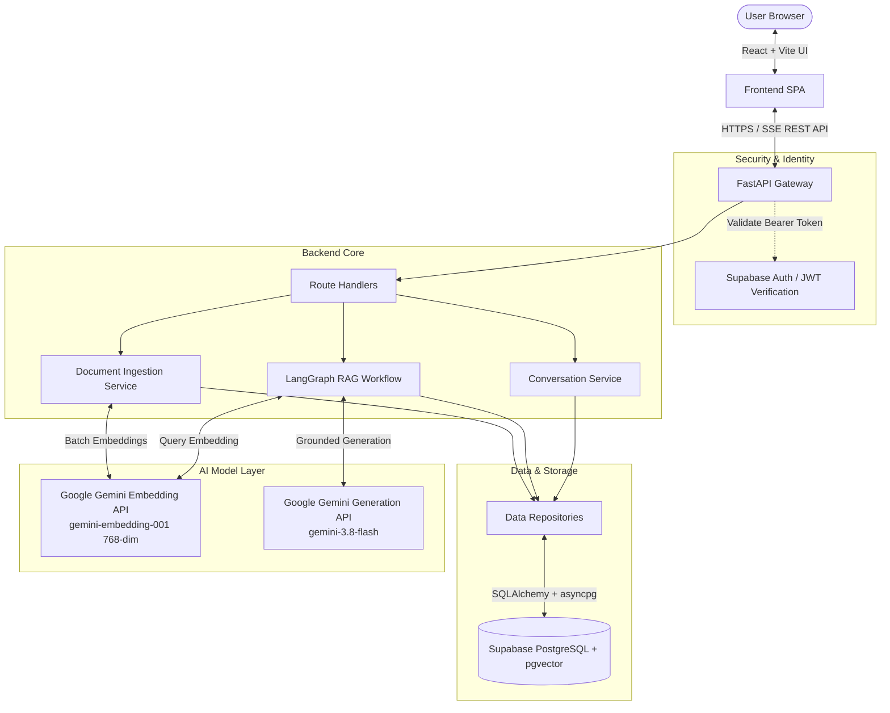

# Architecture Overview — Knowledge AI (RAG Assistant)

Knowledge AI is a production-grade Retrieval-Augmented Generation (RAG) assistant designed around the core principle: **grounded answers over fluent guesses**.

## 1. High-Level System Architecture

## 2. Component Breakdown

### A. Frontend (`/frontend`)
- **Framework**: React 18 / 19 with TypeScript in strict mode, bundled with Vite.
- **Styling**: Tailwind CSS with a modern dark-mode AI palette (zinc / slate / emerald / violet accents).
- **State Management**: TanStack Query (`@tanstack/react-query`) for remote server state, caching, and optimistic updates.
- **Routing**: React Router DOM with protected route guards.
- **Markdown & Code**: `react-markdown` with syntax highlighting.
- **Icons**: `lucide-react`.

### B. Backend (`/backend`)
- **Framework**: FastAPI (async ASGI) on Uvicorn.
- **Data Validation & Settings**: Pydantic v2 and `pydantic-settings`.
- **Database Access**: SQLAlchemy 2.0 async with `asyncpg` driver.
- **Vector Search**: PostgreSQL `pgvector` with HNSW cosine distance indexing (`vector_cosine_ops`).
- **Migrations**: Alembic with versioned schema tracking.

### C. Ingestion Pipeline
- Supports **PDF**, **DOCX**, **TXT**, and **Markdown** documents.
- Multi-step validation: MIME type check, file signature validation, size limit enforcement, empty-content rejection.
- Text cleaning and whitespace normalization preserving structural headings and paragraphs.
- Token-aware chunking (approx 800 tokens, 120 token overlap) with source tracking (filename, page numbers, section headers, chunk indices).
- Batched embedding generation with dimension verification (768 dimensions for `gemini-embedding-001`).
- Document state machine: `PENDING` -> `EXTRACTING` -> `CHUNKING` -> `EMBEDDING` -> `INDEXED` (or `FAILED` with actionable error diagnostics).

### D. RAG Engine & LangGraph Workflow
- Typed state graph (`RAGState`) with explicit nodes:
  1. `validate_and_prepare_query`: Sanitizes input and loads conversation history.
  2. `retrieve_documents`: Embeds query and runs pgvector cosine similarity search filtered by collection and authenticated owner.
  3. `evaluate_evidence`: Computes sufficiency score against retrieval threshold and determines if information is adequate.
  4. `refine_query` (Conditional): If evidence is low and retry count is 0, rewrites query for one targeted retrieval retry.
  5. `generate_answer`: Injects retrieved chunks into an injection-resistant prompt enforcing strict grounding rules.
  6. `validate_citations`: Validates every cited source against actual retrieved chunks before persistence.
  7. `persist_response`: Stores conversation message and verified citation metadata.

## 3. Data Isolation and Multi-Tenancy
- Every database query enforces strict owner scoping (`WHERE owner_id = :current_user_id`).
- All vector search queries in pgvector strictly enforce `owner_id` and `collection_id` constraints at the query and database level.
- No cross-user data leakage is possible even if IDs are guessed.
