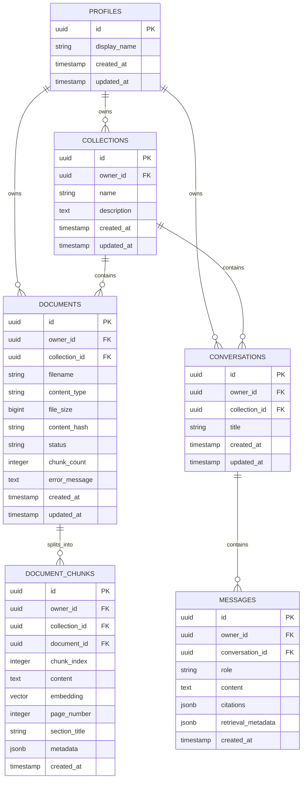

# Database Schema & Migrations — Knowledge AI

## 1. PostgreSQL Schema Overview

The database uses PostgreSQL with the `pgvector` extension enabled.



## 2. pgvector Stored Procedure: `match_document_chunks`

```sql
CREATE OR REPLACE FUNCTION match_document_chunks(
    query_embedding vector(768),
    match_threshold double precision,
    match_count integer,
    target_collection_id uuid,
    target_owner_id uuid
)
RETURNS TABLE (
    id uuid,
    document_id uuid,
    collection_id uuid,
    owner_id uuid,
    chunk_index integer,
    content text,
    page_number integer,
    section_title text,
    metadata jsonb,
    similarity double precision
)
LANGUAGE plpgsql
SECURITY DEFINER
AS $$
BEGIN
    RETURN QUERY
    SELECT
        dc.id,
        dc.document_id,
        dc.collection_id,
        dc.owner_id,
        dc.chunk_index,
        dc.content,
        dc.page_number,
        dc.section_title,
        dc.metadata,
        1 - (dc.embedding <=> query_embedding) AS similarity
    FROM document_chunks dc
    INNER JOIN documents d ON d.id = dc.document_id
    WHERE dc.collection_id = target_collection_id
      AND dc.owner_id = target_owner_id
      AND d.status = 'INDEXED'
      AND (1 - (dc.embedding <=> query_embedding)) >= match_threshold
    ORDER BY dc.embedding <=> query_embedding ASC
    LIMIT match_count;
END;
$$;
```

## 3. Indexing Strategy

- **HNSW Index on Embeddings**:
  `CREATE INDEX idx_document_chunks_embedding_hnsw ON document_chunks USING hnsw (embedding vector_cosine_ops) WITH (m = 16, ef_construction = 64);`
- **B-tree Indexes**:
  - `idx_documents_collection_owner` on `documents(collection_id, owner_id)`
  - `idx_document_chunks_doc_id` on `document_chunks(document_id)`
  - `idx_document_chunks_collection_owner` on `document_chunks(collection_id, owner_id)`
  - `idx_conversations_owner` on `conversations(owner_id)`
  - `idx_messages_conversation` on `messages(conversation_id)`

## 4. Deletion Cascade
`document_chunks` foreign key specifies `ON DELETE CASCADE` for `document_id` and `collection_id`. Deleting a document or collection automatically cleans up all associated vector chunks immediately.
