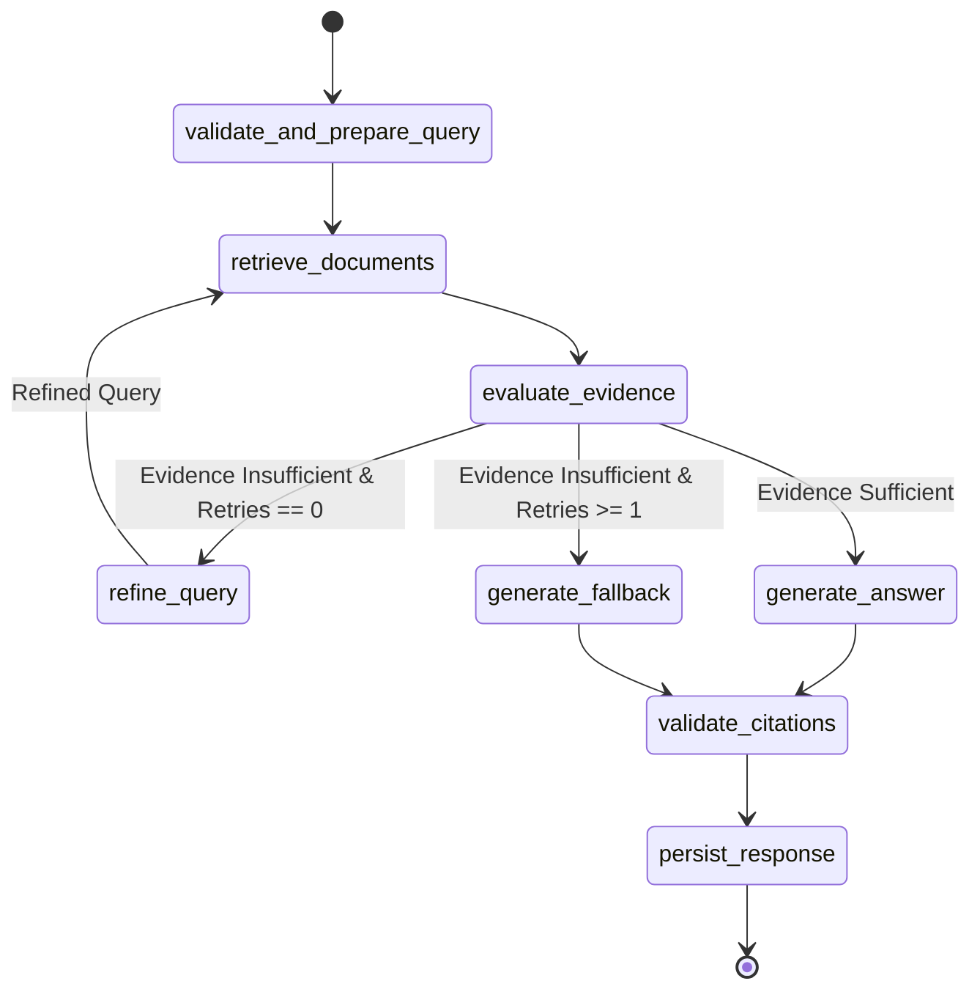

# RAG Pipeline Specification — Knowledge AI

## 1. Document Ingestion Pipeline

### Text Extraction
- **PDF**: PyPDF / PyMuPDF page-by-page extraction preserving 1-based `page_number` metadata.
- **DOCX**: `python-docx` paragraph and table extraction preserving heading section titles.
- **TXT / Markdown**: Direct UTF-8 decoder with line and header tracking.
- Whitespace is normalized: repetitive newlines (> 2) collapsed, non-breaking spaces converted to standard spaces, trailing spaces trimmed.

### Chunking Strategy
- Recursive character splitting with token estimations (approx 4 chars/token).
- **Default chunk size**: 800 tokens (~3200 characters).
- **Default chunk overlap**: 120 tokens (~480 characters).
- Preserves sentence and paragraph boundaries (separators: `["\n\n", "\n", ". ", "? ", "! ", " ", ""]`).
- Chunk metadata payload:
  - `document_id`
  - `collection_id`
  - `owner_id`
  - `chunk_index`
  - `page_number` (optional)
  - `section_title` (optional)
  - `source_filename`
  - `content_hash`

### Embeddings Generation
- Model: `gemini-embedding-001` (Google Gemini with 768-dimension output)
- Output Vector Dimension: 768 dimensions
- Batch size: 64 chunks per batch with exponential backoff on rate limits.
- Validation: Vector dimension must strictly match configured dimension before database write.

---

## 2. Retrieval Mechanics

### Similarity Search
- Distance metric: Cosine distance (`vector_cosine_ops` with `<=>`).
- Similarity score: `1.0 - (embedding <=> query_embedding)`.
- SQL stored procedure: `match_document_chunks`
- Hard isolation: Filters by `owner_id` and `collection_id` at the SQL query level, and verifies `documents.status = 'INDEXED'`.
- Configurable top-k: default 5 chunks.
- Minimum similarity threshold: default 0.30.

---

## 3. LangGraph Workflow



### Typed State Schema (`RAGState`)
```python
class RAGState(TypedDict):
    collection_id: str
    owner_id: str
    conversation_id: str
    query: str
    refined_query: Optional[str]
    history: List[Dict[str, str]]
    retrieved_chunks: List[Dict[str, Any]]
    evidence_sufficient: bool
    retry_count: int
    raw_answer: str
    final_answer: str
    citations: List[Dict[str, Any]]
    metadata: Dict[str, Any]
```

---

## 4. Grounding and Citation Rules

1. **Untrusted Data Context**: Document chunks are rendered inside isolated XML tags (`<evidence>` ... `</evidence>`) with explicit system instructions to ignore prompt-injection attempts inside source documents.
2. **Explicit Reference Badges**: The generator is prompted to refer to sources using `[Chunk: <chunk_id>]`.
3. **Server-Side Validation**:
   - Citations parsed from the answer are validated against `retrieved_chunks`.
   - Any citation referencing an invalid or unretrieved `chunk_id` is stripped or rejected.
   - Verified citations map to:
     - `chunk_id`
     - `document_id`
     - `filename`
     - `page_number`
     - `section_title`
     - `excerpt`
4. **Honest Abstention**:
   If the evidence evaluation determines the retrieved chunks lack sufficient semantic relevance or topical coverage:
   `"I couldn't find enough information in the selected documents to answer that confidently. Try rephrasing the question or uploading a relevant source."`
   The system never fabricates citations or invents facts.
